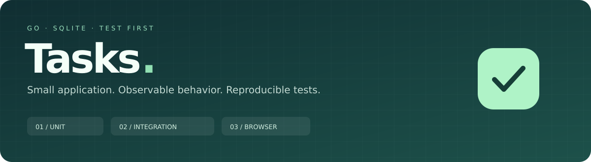
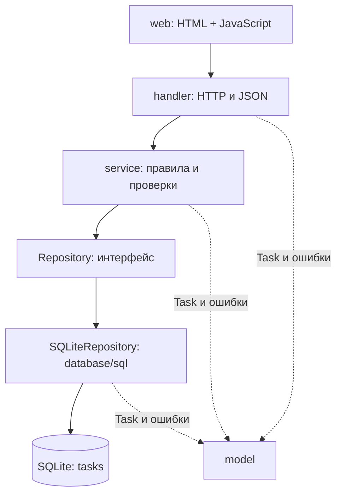

<div align="center">



# Задачи · приложение, которое можно проверить

**Небольшой список задач на Go и полный путь от бизнес-правил до проверки в браузере.**

[](https://github.com/EgorVarshutin05/tasker/actions/workflows/ci.yml)


[](https://github.com/EgorVarshutin05/tasker/actions/workflows/ci.yml)

[](https://github.com/EgorVarshutin05/tasker/actions/workflows/ci.yml)
[](https://github.com/EgorVarshutin05/tasker/actions/workflows/ci.yml)
[](https://github.com/EgorVarshutin05/tasker/actions/workflows/ci.yml)
[](https://github.com/EgorVarshutin05/tasker/actions/workflows/ci.yml)
[](https://github.com/EgorVarshutin05/tasker/actions/workflows/load.yml)


</div>

Это учебный проект с заранее заданным поведением. Здесь можно создать задачу, отметить ее выполненной и удалить. Данные остаются в SQLite после остановки сервера. За простым интерфейсом — отдельные HTTP-обработчики, сервис и репозиторий, поэтому каждый слой можно проверить своим инструментом.

План находится в [`docs/task_test_plan.tex`](docs/task_test_plan.tex). Его журналы и раздел результатов остаются пустыми: факты конкретного прогона собираются отдельно в `reports/`. Сведения о проверке поставляемого архива — в [`verification/STATUS.md`](verification/STATUS.md).

> **Как читать бейджи.** Статусы Build, Race, Unit, Integration, E2E и Security берутся из настоящего workflow `ci.yml`; зеленый статус появляется после завершения всего конвейера. Load использует отдельный `load.yml`. Числа Coverage и Load target — пороги, а не измерения. До привязки репозитория динамические бейджи могут показывать `unknown`. Фиктивные надписи Passing/Verified не проставляются.

## Быстрый старт на Debian

Нужны Go **1.23.12**, GCC, Make и Python 3. Для браузерных тестов используются Node.js **22** и Playwright **1.56.1**. Все команды ниже запускаются из корня проекта.

```bash
sudo apt update
sudo apt install -y build-essential make git curl ca-certificates python3 sqlite3 xz-utils
```

Установка Go 1.23.12 в домашний каталог, без изменения системного Go, для Linux amd64:

```bash
mkdir -p "$HOME/.local/lib"
curl -fL https://go.dev/dl/go1.23.12.linux-amd64.tar.gz -o /tmp/tasks-go.tar.gz
tar -xzf /tmp/tasks-go.tar.gz -C "$HOME/.local/lib"
export PATH="$HOME/.local/lib/go/bin:$PATH"
export CGO_ENABLED=1
go version
```

Для ARM64 используйте официальный архив `go1.23.12.linux-arm64.tar.gz`. Экспорт PATH нужно повторять в новом терминале или добавить в `~/.bashrc`.

```bash
go mod download
make build
./bin/tasks
```

Откройте **http://127.0.0.1:8080/**. Остановка — `Ctrl+C`.

```bash
DB_PATH="$PWD/personal.db" ADDR=127.0.0.1:8081 ./bin/tasks
```

По умолчанию используются `DB_PATH=tasks.db` и `ADDR=127.0.0.1:8080`. Это общий личный список без учетных записей; стандартный адрес доступен только на текущем компьютере.

## Архитектура



`cmd/tasks/main.go` собирает зависимости. При первом открытии файла репозиторий создает таблицу и настраивает WAL, busy_timeout=5000 и один открытый SQL-коннект. HTTP-запросы схему не создают. Complete выполняет UPDATE и SELECT в одной транзакции.

Начальный список выводит `html/template`. После создания JavaScript строит элементы через `createElement` и присваивает название через `textContent`. При загрузке страницы таблица не заменяется запросом fetch.

```text
cmd/tasks/                  точка входа
internal/model/             Task и категории ошибок
internal/service/           бизнес-правила и U01–U05
internal/repository/        SQLite, I01, I02, I07
internal/handler/           HTTP, I03–I06, I08, S03
internal/testutil/           F0/F1 и независимые SQL-проверки
web/                        встроенный HTML/CSS/JS
e2e/                        A01–A05, S04, S05
load/                       S01, S02 и общие метрики k6
tools/                      покрытие, стенд, нагрузка, упаковка
docs/                       исходный план и пояснения
.github/workflows/          CI и ручной нагрузочный прогон
verification/               факты проверки поставляемого архива
```

## Контракт API

| Запрос | Код | Результат |
|---|---:|---|
| `GET /` | 200 | HTML с начальным списком |
| `POST /api/tasks`, `{"title":"Отчет"}` | 201 | `{"id":1,"title":"Отчет","done":false}` на новой БД |
| `GET /api/tasks` | 200 | Массив задач по возрастанию ID, в том числе `[]` |
| `PATCH /api/tasks/1/done` | 200 | Задача с `done=true`; повтор возвращает то же состояние |
| `DELETE /api/tasks/1` | 204 | Тело 0 байт |

Название: UTF-8, TrimSpace, от 1 до 100 кодовых точек Unicode. ID: от 1 до 2147483647; в URL без знака и ведущих нулей. Одинаковые названия разрешены. Новый ID не переиспользуется после удаления.

JSON-ответы имеют `Content-Type: application/json; charset=utf-8`. Для POST допускается `application/json` с необязательным `charset=utf-8`. Поле title обязательно и имеет тип string. Неизвестные поля, null, число, отсутствующее поле и второе JSON-значение дают `400 {"error":"bad_json"}`.

| Причина | HTTP | Поле error |
|---|---:|---|
| Название вне правил | 400 | `title_length` |
| ID вне правил | 400 | `bad_id` |
| Запись отсутствует | 404 | `not_found` |
| Сбой SQLite | 500 | `storage` |
| Метод не разрешен | 405 | `method` и заголовок Allow |
| Путь отсутствует | 404 | `route` |
| Content-Type не поддерживается | 415 | `media_type` |

```bash
curl -i -H 'Content-Type: application/json' \
  -d '{"title":"Отчет"}' http://127.0.0.1:8080/api/tasks
curl -i http://127.0.0.1:8080/api/tasks
curl -i -X PATCH http://127.0.0.1:8080/api/tasks/1/done
curl -i -X DELETE http://127.0.0.1:8080/api/tasks/1
```

## Трассировка тестов

| ID | Проверка | Требования | Реализация |
|---|---|---|---|
| U01 | TrimSpace и аргумент Repository.Create | F01 | `internal/service/service_test.go` |
| U02 | 0/1/100/101 символ, пробелы, не-UTF-8 | F01, F05 | там же |
| U03 | Complete/Delete: 1, max, 0, -1, max+1 | F03–F05 | там же |
| U04 | Порядок списка, пустой и nil-срез | F02 | там же |
| U05 | ErrStorage и ErrNotFound, счетчики вызовов | F05 | там же |
| I01 | Реальная запись/чтение, SQL и PRAGMA | F01, F02 | `internal/repository/sqlite_test.go` |
| I02 | Повтор Complete и физическое Delete | F03–F05 | там же |
| I03 | POST → GET → PATCH → DELETE → GET | F01–F04 | `internal/handler/integration_test.go` |
| I04 | Отказы JSON/ID/метода/пути/Content-Type | F05 | там же |
| I05 | Закрытая БД, HTTP 500 без текста драйвера | F05 | там же |
| I06 | Дополнительные границы HTTP и серверный HTML | F05, N03 | там же |
| I07 | CHECK, PRAGMA, отказ открытия, rollback и Scan | F01, F03–F05 | `internal/repository/sqlite_test.go` |
| I08 | Параллельные HTTP-запросы и уникальность ID | F01, F02 | `internal/handler/integration_test.go` |
| A01 | Форма создания и баннер для пробелов | F01, F05 | `e2e/tests.spec.ts` |
| A02 | Пустая таблица и порядок ID | F02 | там же |
| A03 | Завершение и реальный перезапуск процесса | F03, F06 | там же |
| A04 | Удаление в DOM, API и SQL | F04, F05 | там же |
| A05 | DROP TABLE на живой БД и баннер | F05 | там же |
| S01 | 50 RPS чтения, p95, счетчики, пустая БД | N01 | `load/s01_read.js` |
| S02 | 50 RPS записи, уникальность и число строк | N01, F01 | `load/s02_write.js` |
| S03 | SQL-инъекция сохраняется как текст | N02 | `internal/handler/integration_test.go` |
| S04 | XSS при динамическом добавлении строки | N03 | `e2e/tests.spec.ts` |
| S05 | XSS в исходном HTML и DOM | N03 | там же |

Каждый набор U/I получает собственную заглушку или отдельный временный SQLite-файл. F0 — новая пустая схема, F1 — одна запись `(1,"Отчет",0)`. Состояние БД проверяется независимыми SQL-запросами. Браузерные тесты используют отдельные процессы и файлы, без подмены HTTP.

## Go-тесты, гонки и покрытие

```bash
make test-unit
make test-integration
make test-security
make coverage
make branches
make vet
```

`make test-unit` и `make test-integration` запускают соответствующие наборы с `-race`. JSONL и читаемые логи одного и того же прогона сохраняются в `reports/`.

`make coverage` запускает весь набор Go-тестов с `-race -covermode=atomic`, создает HTML и проверяет пороги: **85%** для service/repository/handler в совокупности и **90%** для service. Повторяющиеся блоки из разных тестовых бинарных файлов объединяются так же, как в `go tool cover`; проценты по пакетам не усредняются.

`make branches` создает временную копию исходников, добавляет диагностические счетчики исходов решений и повторяет Go-тесты. Проверяются обе стороны if и условного for, а также case/default. Пороги: **80%** суммарно и **100%** для service. Итерации range и MC/DC в эту метрику не входят. Измерение операторов не подменяет измерение ветвей. Поставляемый бинарный файл не содержит счетчиков.

Подробности и ограничения: [`docs/coverage.md`](docs/coverage.md).

## Playwright: браузер и XSS

Node.js 22 можно установить из официального Linux-архива в домашний каталог. Для amd64:

```bash
mkdir -p "$HOME/.local/lib"
curl -fL https://nodejs.org/dist/v22.14.0/node-v22.14.0-linux-x64.tar.xz -o /tmp/tasks-node.tar.xz
tar -xJf /tmp/tasks-node.tar.xz -C "$HOME/.local/lib"
export PATH="$HOME/.local/lib/node-v22.14.0-linux-x64/bin:$PATH"
node --version
npm --version
```

Для ARM64 используйте вариант `linux-arm64`. Затем установите закрепленные зависимости и браузер:

```bash
cd e2e
npm ci
npx playwright install --with-deps chromium
cd ..
make test-e2e
```

A03 завершает процесс, дожидается его остановки и запускает новый процесс с прежним DB_PATH. A05 выполняет DROP TABLE через независимый Python sqlite3-клиент; открытый браузер и HTTP-слои остаются настоящими. S05 разбирает сырой HTML библиотекой parse5 до проверки DOM.

Если требуется установленный системный Chromium, можно указать путь явно:

```bash
PLAYWRIGHT_CHROMIUM_EXECUTABLE_PATH=/usr/bin/chromium make test-e2e
```

Ожидания DOM — до 2 с после ответа, HTTP — до 5 с. В S04/S05 дополнительные 500 мс — заданное планом окно наблюдения за XSS, а не способ ожидания обновления таблицы.

```bash
cd e2e
npx playwright show-report
```

## Нагрузочные тесты k6

Для Linux amd64 установите k6 0.57.0:

```bash
curl -fL https://github.com/grafana/k6/releases/download/v0.57.0/k6-v0.57.0-linux-amd64.tar.gz -o /tmp/tasks-k6.tar.gz
tar -xzf /tmp/tasks-k6.tar.gz -C /tmp
sudo install /tmp/k6-v0.57.0-linux-amd64/k6 /usr/local/bin/k6
make test-load
```

Для ARM64 нужен соответствующий архив k6. Общая длительность двух сценариев — около **140 секунд**: по 10 с прогрева и 60 с измерения. Прогрев и измерение используют разные файлы БД, включая сценарий записи. Рабочий `tasks.db` не затрагивается.

| Параметр | Порог измерительного прогона |
|---|---|
| Executor | constant-arrival-rate |
| Частота / длительность | 50 итераций/с, 60 с, один запрос на итерацию |
| VU | preAllocatedVUs=20, maxVUs=100 |
| Завершенные запросы | не менее 2940 |
| RPS | N/60 не менее 49; дополнительно threshold Counter rate>=49 |
| p95 | не более 200 мс |
| 5xx / dropped iterations / HTTP failures | 0 / 0 / 0 |
| k6 checks | доля 1 |
| SQL после S02 | COUNT(*), COUNT(DISTINCT id) и число заданных названий равны N201 |

`tools/run_load.py` сохраняет JSON-сводки, логи, независимые SQL-проверки и параметры стенда. Плановые 3000 запросов могут отличаться на один из-за включения границы интервала планировщиком k6; приемка использует пороги плана и фактический счетчик N.

Опорный стенд плана: Linux x86-64, 2 CPU/2 ГиБ для сервера, локальный SSD; еще 2 CPU для генератора, RAM хоста от 8 ГиБ. На выделенном стенде CPU можно разделить так:

```bash
SERVER_CPUS=0,1 LOAD_CPUS=2,3 make test-load
```

CPU должны входить в разрешенный cpuset. Лимит памяти сервера и тип носителя фиксируются отдельно; скрипт сам не создает cgroup. Обычный ноутбук или GitHub-hosted runner дают измерение на своем оборудовании: его нельзя выдавать за результат опорного стенда без проверки ресурсов.

## PDF плана

```bash
sudo apt install -y texlive-latex-base texlive-latex-recommended \
  texlive-latex-extra texlive-lang-cyrillic cm-super
make pdf
```

Результат: `reports/pdf/task_test_plan.pdf`. Исходник рассчитан на pdfLaTeX и пакеты, доступные в TeX Live 2019. Make выполняет две компиляции для содержания. Разделы 4–6 остаются шаблонами до оформления результатов конкретного прогона.

## GitHub Actions и бейджи

Создайте пустой репозиторий на GitHub и привяжите ссылки в README:

```bash
python3 tools/configure_badges.py YOUR_GITHUB_LOGIN YOUR_REPOSITORY_NAME
git init -b main
git add .
git commit -m "feat: add tasks app and complete test suite"
git remote add origin https://github.com/YOUR_GITHUB_LOGIN/YOUR_REPOSITORY_NAME.git
git push -u origin main
```

`ci.yml` запускается на каждый push и pull request:

1. Сборка, gofmt, vet, U01–U05 и детектор гонок.
2. После Unit: I01–I08, SQLi S03, покрытие операторов и исходов решений.
3. После Integration: Playwright A01–A05 и XSS S04–S05.
4. Сохранение логов, coverage.out, coverage.html, Playwright HTML/JSON/JUnit/trace и проверенного Linux-бинарного файла.

Доставка в этом проекте — артефакт `tasks-linux-amd64` после всех проверок. Публикация сервера на внешнем хосте требует отдельного адреса и окружения развертывания; этот архив их не предполагает.

Нагрузка вынесена в `load.yml` с ручным запуском **Actions → Load k6 S01-S02 → Run workflow**. Это не добавляет нестабильный аппаратный benchmark к каждому pull request. Результаты и данные стенда сохраняются как `k6-measurements`.

## Что переносить в разделы 4–6 отчета

```bash
make environment
make test-unit test-integration test-security coverage branches
make test-e2e
make test-load
```

| Данные | Источник |
|---|---|
| Версии, время, платформа, commit, хеш плана | `reports/environment.json` |
| ID наборов, время, фактические статусы Go | `reports/unit.jsonl`, `integration.jsonl`, `security-sql.jsonl` |
| Фактическое покрытие операторов | `reports/coverage-summary.json`, `coverage.out`, `coverage.html` |
| Условия, исходы и пропущенные ветви | `reports/branches/manifest.json`, `summary.json`, `events/` |
| A/S: статусы, длительность, ошибки, trace | `e2e/test-results/`, `e2e/playwright-report/` |
| N, p95, 5xx, проверки SQL и ресурсы | `reports/load/` |
| Образец пустых журналов и решения о приемке | разделы 4–6 `docs/task_test_plan.tex` |

Одна строка журнала относится к именованному набору. PASS ставится только при совпадении всех сравнений; сбой окружения фиксируется как BLOCKED. Если есть дефект, заведите BUG-001 с входом, фактическим значением и ссылкой на лог. Шаблоны не заполняются придуманными результатами.

## Повторная упаковка

```bash
python3 tools/archive.py
```

Создается `dist/tasks-testing-project.zip` с полным исходным кодом, lock-файлами, конфигурацией CI и документацией. Бинарные зависимости, node_modules, временные БД и каталоги reports в архив исходников не включаются.
